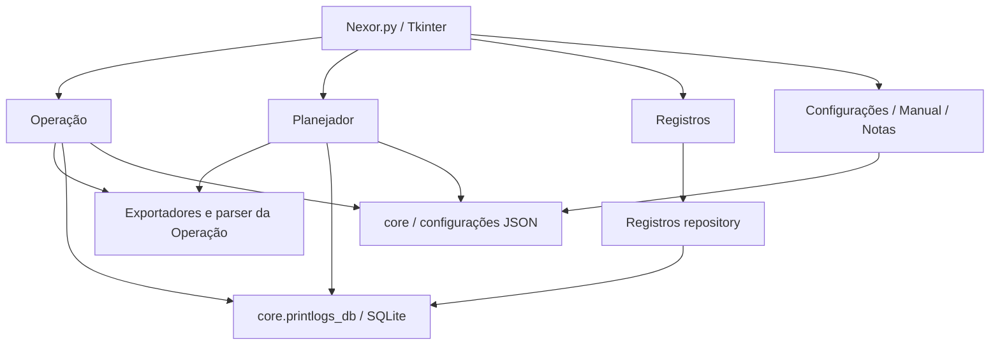

# Nexor: arquitetura e estado atual

Referência: código de trabalho em 05/11/2026, versão mantida em **1.6.39**. Recursos futuros constam no [roadmap](../roadmaps/nexor-modernization-roadmap.md).

**Nota 13/11/2026, versão 1.6.61.** A estrutura/dependências abaixo continuam corretas; o que mudou desde 05/11/2026 foi recurso novo, registrado no `CHANGELOG.md` (vendedores/rastreabilidade de PDF, comprovante "Prisma", verificação de impressão real da M1 e detecção de impressão física incompleta) — módulos novos como `core/vendedores.py`, `core/order_files.py`, `core/order_pdfs.py`, `core/order_vendor_resolution.py`, `core/prisma_report.py`, `modules/operacao/m1_check.py`, `modules/operacao/print_check.py` e `modules/operacao/vendor_pdf_apply.py` ainda não aparecem no diagrama/tabela abaixo. Nenhum dos mecanismos descritos aqui (JSON atômico, SQLite, logging, PX Tool Box) mudou de comportamento nesse meio-tempo.

**Nota 16/11/2026, versão 1.6.64.** Mesma estrutura; só mais dois incrementos do Prisma (Planejador + correção de truncamento, ver `CHANGELOG.md`), nenhuma mudança de arquitetura/mecanismo. Auditoria P0 desta data confirmou (evidência real, não suposição): suíte isolada com 455 casos passando, `compileall` limpo, e o executável `dist\Nexor-1.6.64.exe` abrindo de verdade (processo real com o título de janela esperado) — ver notas correspondentes em `technical-debt.md` e no roadmap.

## Estrutura e dependências

```text
Nexor.py                     Shell Tkinter, navegação e tratamento de falhas
core/                        Configuração, persistência, regras comuns, UI e temas
modules/operacao/             Leitura de logs, modelos, regras, relatórios e interface
modules/planejador.py         Fila, cálculo por DPI, relatórios e interface do planejador
modules/registros/           Consultas, versões, interface e exportação de contexto
modules/configuracoes.py     Interfaces de configuração e editor de tipos
modules/manual.py            Manual embarcado
tests/                       unittest com arquivos e bases temporários
scripts/run-tests-isolated.py Ambiente isolado antes da descoberta de testes
Nexor.spec                   Definição do executável Windows
```



Não há uma camada de serviços independente cobrindo todos os módulos. O Planejador importa exportadores/parser da Operação e funções de configuração. Registros usa um repositório fino sobre `core.printlogs_db`; ao reabrir um rolo, a interface carrega o módulo de origem sob demanda. Os pacotes `modules.operacao` e `modules.registros` expõem `build_ui` e importam suas interfaces no `__init__.py`, inclusive quando outro código importa um submódulo desses pacotes.

O shell carrega módulos dinamicamente. O spec lista esses imports para o PyInstaller. Temas e componentes visuais comuns estão em `core/theme.py` e `core/ui.py`; regras de tecidos, operadores e tipos ficam em módulos de `core`. As entidades Python `Job` são nomes internos compatíveis; na interface representam arquivos, itens e trabalhos de impressão. O CSV mantém os literais técnicos de tipo `JOB` e `ESPACO`, e o JSON mantém a chave `job`, para preservar os formatos já exportados.

## Fluxos atuais

**Operação:** logs TXT → parser e classificação → itens/avanços e blocos por tecido → resumo e relatórios → persistência transacional do rolo, itens e evento. A metragem vem de `HeightMM`; avanços são itens de espaço separados. A importação pode conferir o registro diário de uma impressora por `m1_check.py`. Não existe coletor de rede nem agente de sincronização.

**Planejador:** imagens/itens manuais → cálculo por pixels/DPI e parâmetros da fila → organização de rolos e espaços → PDF/JPG e histórico. O módulo administra o uso de pedaços de tecido. Cálculo, estado visual e coordenação dos relatórios ainda estão concentrados em um arquivo grande.

**Registros:** consultas do SQLite → filtros/resumo/detalhes/eventos/versões → abertura do comprovante, reedição no módulo de origem ou exportação explícita de contexto. Editar um rolo mantém versões anteriores; diagnóstico e backup não utilizam esse fluxo de migração/escrita.

## Caminhos e responsabilidades

| Dado | Caminho atual no Windows | Observações |
| --- | --- | --- |
| Configuração principal | `%APPDATA%\PXCore\config.json` | Tema, pasta base, preferências DEV e `installation_id`. |
| Configuração comum por módulo | `%APPDATA%\PXCore\modules\<nome>.json` | Estação, exportação e preferências que usam `module_config_path`. |
| Impressoras | `%APPDATA%\Nexor\printers.json` | Cadastro local e migração compatível do caminho histórico. |
| Tecidos | `%APPDATA%\Nexor\Planejador\fabrics.json` | Nomes canônicos, aliases e comprimentos de rolo. |
| Pedaços de tecido | `%APPDATA%\Nexor\Planejador\scraps.json` | Cadastro e estado de uso. |
| Preferências da Operação | `%APPDATA%\Nexor\Operacao\config.json` | Migração de `%APPDATA%\ProjetoJocasta\PXPrintLogs`. |
| Banco de produção | `<base_dir>\data\printlogs.db` | Compartilhado quando a pasta configurada é de rede. |
| PDFs | `<base_dir>\pdf\<módulo>\rolls\AAAA\MM` | Comprovantes. |
| JPGs | `<base_dir>\print\<módulo>\jpg\AAAA\MM` | Saídas de impressão/registro. |
| Temporários de produção | `<base_dir>\temp\<módulo>` | Independentes dos temporários da suíte. |
| Log técnico | `%LOCALAPPDATA%\Nexor\logs` | Rotação de 2 MiB e três arquivos anteriores. |

A configuração principal usa `~/.config/PXCore` fora do Windows, mas alguns cadastros legados usam `APPDATA` ou a pasta pessoal diretamente. O `config.json` na raiz do repositório não é a configuração principal de `core.config` e não deve ser tratado como modelo da instalação ativa.

## Configurações JSON e recuperação

`core/json_store.py` centraliza leitura/validação e gravação atômica: arquivo temporário no mesmo diretório, flush/fsync e substituição por `os.replace`. Uma falha mantém o arquivo anterior, e os erros preservam a causa. Arquivo ausente pode receber defaults de primeiro uso; arquivo existente vazio, inválido, inacessível ou com estrutura errada não autoriza sobrescrever seu conteúdo com defaults.

As exceções `ConfigurationReadError`, `ConfigurationValidationError` e `ConfigurationWriteError` derivam de `ConfigurationError`. `core.config` reexporta a base e o alias `ConfigError`. Os fluxos da interface devem apresentar a falha e manter a tela utilizável. A substituição atômica evita truncamento pela própria gravação, mas não coordena alterações simultâneas de duas instâncias.

Recuperação é uma operação explícita, separada da leitura:

```python
from core.json_store import recover_json_config

# Caminho deliberadamente escolhido para recuperação e defaults válidos.
preserved_path = recover_json_config(path, defaults, validator=validator)
```

A função preserva os bytes originais em um arquivo irmão `<nome>.recovery-<uuid>.bak` antes de instalar os defaults. Retorna o caminho preservado, ou `None` quando não há original para preservar. Não é executada automaticamente pelo carregamento normal. Isso não reconstrói os valores perdidos de um JSON danificado. O validador opcional recebe `(valor, caminho)`; as APIs comuns de leitura/escrita são `read_json_config(path, defaults, *, validator=None)` e `write_json_config(path, value, *, validator=None)`.

## Senha DEV local

`core.config` mantém as assinaturas `hash_password`, `verify_dev_password` e `set_dev_password`. Novas senhas usam PBKDF2-HMAC-SHA256 da biblioteca padrão, 600.000 iterações, salt aleatório de 16 bytes e derivação de 32 bytes; a verificação usa comparação em tempo constante. A escolha evita uma dependência nova e segue o parâmetro publicado para PBKDF2-SHA256 na [orientação da OWASP](https://cheatsheetseries.owasp.org/cheatsheets/Password_Storage_Cheat_Sheet.html).

SHA-1 é aceito somente para configurações antigas. A migração ocorre após autenticação correta e persistência bem-sucedida; senha incorreta, hash malformado ou erro de gravação não apagam o legado. A preferência é local e não substitui permissões do sistema operacional. O shell atual não oferece um fluxo ativo de autenticação DEV: os helpers existem, mas não há um novo controle de acesso da interface nesta etapa.

## SQLite: gravação, diagnóstico e backup

`core.printlogs_db.connect()` mantém o banco operacional, habilita chaves estrangeiras, usa `journal_mode=DELETE` e espera de bloqueio de 5.000 ms. Exportações agrupam rolo, itens e evento em transação; falha deve produzir rollback e não pode ser anunciada como gravação completa. Migrações preservam as tabelas e os dados históricos compatíveis, incluindo `roll_original_orders`. Os hashes de identidade da produção não mudam com a derivação de senha DEV.

As APIs técnicas recebem caminhos explícitos:

```python
from core.sqlite_maintenance import diagnose_database, backup_database

report = diagnose_database(source_path, timeout_ms=5000)
backup_path = backup_database(source_path, destination_path, timeout_ms=5000)
```

O diagnóstico abre a origem em modo somente leitura, sem `ensure_schema` nem migração. O `IntegrityReport` expõe `integrity_messages`, `foreign_key_violations`, `check_errors` e a propriedade `healthy`. As violações incluem tabela, rowid, tabela pai e índice da chave. Fonte ausente não é criada. Falhas operacionais/bloqueio geram `DatabaseUnavailableError` com causa; uma base sem integridade para backup gera `DatabaseIntegrityError` com o relatório.

O backup usa a API do SQLite e um snapshot de leitura, reserva um destino novo e verifica o resultado. A pasta do destino deve existir; qualquer arquivo de destino preexistente é recusado. Após falha, tenta remover apenas o arquivo parcial criado pela tentativa; se o sistema negar a remoção, ele permanece com a falha registrada e nunca é anunciado como backup válido. A API copia dados confirmados de forma consistente; veja a [referência do sqlite3 do Python](https://docs.python.org/3.13/library/sqlite3.html#sqlite3.Connection.backup).

O snapshot mantém uma transação de leitura durante a verificação/cópia e pode atrasar gravadores. `timeout_ms` limita a espera por bloqueios; não limita o tempo total de uma base grande. Erros de acesso distinguem bloqueio, permissão, arquivo/pasta ausente e falhas de armazenamento/rede, mantendo a causa original.

Não existe nova tela ou agenda automática de manutenção. Restaurar uma base requer interromper seu uso e selecionar uma cópia validada; não ocorre automaticamente. Um backup sem ensaio de restauração não comprova recuperação operacional.

### Pasta de rede

Manter `DELETE` evita introduzir WAL em uma implantação compartilhada existente. A espera de bloqueio reduz falhas transitórias, mas depende dos locks e da durabilidade oferecidos pelo compartilhamento. Nenhum desses ajustes garante segurança de escrita simultânea em SMB ou durante interrupções de rede. A [documentação do SQLite sobre arquivos remotos](https://sqlite.org/useovernet.html) descreve limitações de locking e I/O; suas [causas de corrupção](https://sqlite.org/howtocorrupt.html) incluem sistemas de arquivos com locks inadequados e cópia/restauração durante transações.

Testes locais não validam o servidor SMB, queda de energia ou concorrência das estações reais. Antes de ampliar usuários simultâneos, medir o ambiente e avaliar acesso a uma base local por um serviço.

## Log técnico e fronteiras de erro

`core.logging_config` expõe `configure_logging(log_dir=None, *, level=INFO)`, `get_logger(name)` e `log_exception(logger, fixed_message, exc)`. Usa o namespace `nexor` e rotação, sem duplicar handlers ao repetir a configuração. O destino padrão é local ao computador e separado do banco e dos logs da impressora; fora do Windows usa `$XDG_STATE_HOME/Nexor/logs` ou `~/.local/state/Nexor/logs`.

Os eventos trazem horário, nível, módulo e traceback técnico seguro. Mensagens de contexto são fixas; senhas/hashes, JSON completo, nomes de pedidos e caminhos de produção não devem ser incluídos. Falhas de startup, callbacks Tk, importação dinâmica, gravação e exportação precisam ser visíveis na interface. Quando um relatório foi criado, mas o registro no banco falhou, o resultado é parcial e precisa ser apresentado dessa forma.

## Contrato com PX Tool Box

A exportação de `modules/registros/px_export.py` produz um JSON escolhido explicitamente pelo usuário. Preserva o contrato existente com `rollId`, `jobHash`, etiqueta do pedido informado, tecido, tipo e referência de origem. `rollId` e `jobHash` têm escopo da base; `databaseId` identifica a linhagem do arquivo de banco e permanece em cópia/restauração. `installationId` identifica a instalação e não resolve sozinho bases diferentes ou bases compartilhadas.

Espaços/avanços não geram contexto. Exportar não modifica o rolo e não abre nem envia dados automaticamente ao PX Tool Box/Corel. O usuário importa o arquivo no outro aplicativo. A confirmação de gravação e as ações auxiliares de mostrar/copiar o caminho são independentes.

## Dependências, testes e evidência

`requirements.txt` fixa as quatro bibliotecas externas do código ativo. `requirements-build.txt` acrescenta o toolchain Windows e suas dependências transitivas inspecionadas. Tcl/Tk e sqlite3 vêm do Python; `unittest` dispensa pytest. Os pins registram o ambiente conhecido e não representam uma auditoria de vulnerabilidades ou instalação limpa já validada.

O runner é `python scripts/run-tests-isolated.py -v`. Ele redireciona os perfis/configurações/temporários antes da descoberta, usa uma base temporária e remove somente sua pasta em `build/test-runs/`. Testes continuam responsáveis por isolar caminhos que injetem diretamente. A CI prevê Windows/Linux em Python 3.13, sem publicação ou executável. Usa `checkout@v7` e `setup-python@v7`, conforme os exemplos oficiais de [checkout](https://github.com/actions/checkout) e [setup-python](https://github.com/actions/setup-python), com permissão somente de leitura e sem persistir credenciais no checkout.

O comando opcional `python scripts/smoke-ui-isolated.py` requer uma sessão gráfica Windows e Tcl/Tk. Foi executado com TkinterDnD, dados descartáveis em `build/ui-smoke/` e janela transparente: startup, seis páginas, oito temas, navegação na resolução mínima 980×600 e configuração principal inválida preservada com aviso e ajuda acessível. Isso verifica construção e estado básico dos controles; não é revisão visual completa, importação de dados de impressora nem execução de todos os fluxos do operador.

Os testes locais, compilação e inspeção do arquivo do executável não demonstram execução remota da CI, inicialização do executável congelado, instalador, impressora, restauração real ou homologação SMB. Foi criado um executável de validação em `dist/foundation-validation-20261105-144030/`; a inspeção confirmou os arquivos Tcl/Tk e o `CHANGELOG.md` no arquivo. O spec conserva o fallback Tcl/Tk portátil Windows, condicionado à falha da detecção normal e à presença dos arquivos esperados.
